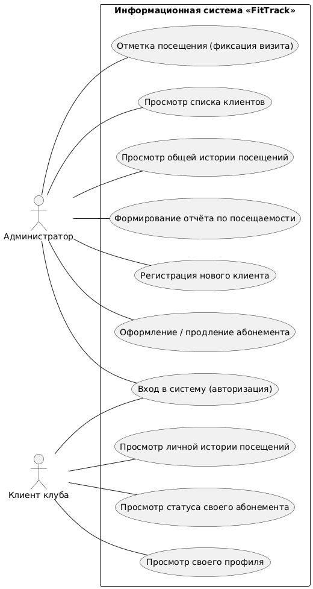
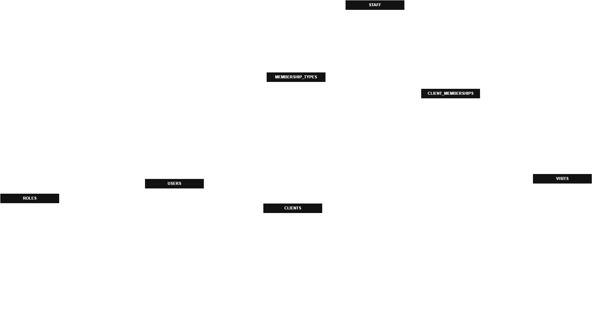

# Информационная система учёта посещений спортивного клуба «FitTrack»

<p align="center">
  
  
  
  
</p>

---

> **FitTrack** — программный комплекс, предназначенный для комплексной автоматизации процессов учёта клиентов, контроля статуса клубных карт, оперативной фиксации визитов на тренировки и формирования аналитической отчётности спортивного зала.

---

## 📋 Оглавление
- [Информационная система учёта посещений спортивного клуба «FitTrack»](#информационная-система-учёта-посещений-спортивного-клуба-fittrack)
  - [📋 Оглавление](#-оглавление)
  - [🎯 Цель и задачи проекта](#-цель-и-задачи-проекта)
    - [Ключевые задачи системы:](#ключевые-задачи-системы)
  - [👥 Роли пользователей и матрица доступа](#-роли-пользователей-и-матрица-доступа)
  - [⚙️ Функциональные возможности](#️-функциональные-возможности)
  - [🏗 Архитектура системы](#-архитектура-системы)
  - [📊 Моделирование процессов](#-моделирование-процессов)
    - [Диаграмма прецедентов (Use Case)](#диаграмма-прецедентов-use-case)
    - [Диаграмма сущностей и связей (ER-диаграмма)](#диаграмма-сущностей-и-связей-er-диаграмма)
      - [Описание ключевых сущностей:](#описание-ключевых-сущностей)
    - [Ключевые алгоритмы работы:](#ключевые-алгоритмы-работы)
  - [📁 Структура репозитория](#-структура-репозитория)
  - [🚀 Установка и запуск](#-установка-и-запуск)
    - [Системные требования](#системные-требования)
    - [Инструкция по развёртыванию](#инструкция-по-развёртыванию)
  - [👩‍💻 Сведения об авторе](#-сведения-об-авторе)

---

## 🎯 Цель и задачи проекта

**Цель разработки:** создание программного комплекса для автоматизации учёта посещений фитнес-клуба, мониторинга клиентской базы и управления абонементами в едином информационном пространстве.

### Ключевые задачи системы:
* **Кадровый и клиентский учёт:** хранение персональных данных посетителей (ФИО, телефон, дата рождения) с обязательной валидацией возраста (14+), префикса номера (+7) и разграничением ролей (Администратор/Клиент).
* **Управление абонементами:** первичное оформление разовых, лимитных или безлимитных карт, автоматический расчет сроков их действия, продление и онлайн-контроль уникальности номеров для защиты от перезаписи.
* **Фиксация посещений:** валидация права входа клиента на ресепшене (автоматическая проверка активности карты, баланса тренировок и срока действия), списание занятий и ведение электронного журнала визитов.

---

## 👥 Роли пользователей и матрица доступа

В системе реализована ролевая модель доступа (**RBAC**), разделяющая полномочия на два уровня:

| Роль | Права | Описание и доступные функции |
| :--- | :---: | :--- |
| **Администратор** *(Сотрудник ресепшен)* | **RW** *(Полный доступ)* | Регистрация и удаление клиентов, оформление и удаление клубных карт, регистрация посещений с валидацией карты, просмотр общего журнала визитов и формирование сводной отчётности. |
| **Клиент** *(Посетитель клуба)* | **RO** *(Только чтение)* | Персональная авторизация, просмотр данных личного профиля, мониторинг остатка занятий и срока действия своего абонемента, просмотр личной истории посещений. |

---

## ⚙️ Функциональные возможности

Комплекс функций системы сгруппирован по бизнес-модулям:
1. **Управление клиентской базой:**
   * Регистрация нового посетителя с автоматическим созданием аккаунта для входа в личный кабинет;
   * Интерактивная валидация данных «на лету» (проверка формата телефона строго на +7, ограничение возраста 14+, автоисправление ФИО на заглавные буквы);
   * Полное безопасное удаление клиента и его учетной записи из системы с сохранением целостности связей в базе данных.
2. **Управление клубными картами и тарифами:**
   * Оформление и привязка абонементов разных типов (разовые, лимитные на 12 визитов, безлимитные на месяц);
   * Автоматическая генерация уникального номера бесконтактной карты по стандарту (CARD-1000X) на основе максимального ID в базе;
   * Онлайн-контроль безопасности при продаже: предупреждение администратора о наличии действующей карты и защита от случайной перезаписи тарифа.
3. **Фиксация визитов и контроль доступа (Турникет):**
   * Автоматическая проверка валидности абонемента по ID клиента при входе (сверка срока действия карты и баланса занятий);
   * Списание тренировки (для лимитных карт) и пропуск в зал без списания баланса (для безлимитных тарифов);
4. **Информационная панель и самообслуживание (Личный кабинет):**
   * Просмотр клиентом персонального профиля и актуальных контактных данных;
   * Онлайн-контроль статуса карты (название тарифа, точная дата окончания и остаток доступных тренировок);
   * Доступ посетителя к собственной персональной истории тренировок.


---

## 🏗 Архитектура системы

Программный комплекс строится по принципам классической **трёхуровневой архитектуры** (*3-Tier Architecture*):

```text
┌────────────────────────────────────────────────────────┐
│         Слой интерфейса (Presentation Layer)           │
│    Консольный / Графический интерфейс, валидация ввода │
└───────────────────────────┬────────────────────────────┘
                            │ (DTO / Команды)
┌───────────────────────────▼────────────────────────────┐
│          Слой бизнес-логики (Business Logic Layer)     │
│   Валидация абонементов, учет визитов, расчет отчетов  │
└───────────────────────────┬────────────────────────────┘
                            │ (CRUD / Запросы)
┌───────────────────────────▼────────────────────────────┐
│                 Слой данных (Data Layer)               │
│     DAO / Репозиторий доступа ───► Реляционная БД      │
└────────────────────────────────────────────────────────┘
```

* **Слой интерфейса:** обеспечивает взаимодействие администратора и клиента с системой (CLI/GUI/Web), сбор входных данных и вывод системных сообщений.
* **Слой бизнес-логики:** выполняет валидацию входных форматов, проверку активности и сроков годности абонементов, обработку факта визита и генерацию аналитических отчётов.
* **Слой данных:** отвечает за надёжное долговременное хранение информации о клиентах, клубных картах и журналах визитов, обеспечивая транзакционную целостность.

---

## 📊 Моделирование процессов

### Диаграмма прецедентов (Use Case)
Отражает сценарии взаимодействия пользователей с системой «FitTrack»:

<p align="center">
  
</p>

> Исходный декларативный код диаграммы сохранён в формате PlantUML: [docs/diagrams/usecase.puml](docs/diagrams/usecase.puml).

---

### Диаграмма сущностей и связей (ER-диаграмма)
Отражает реляционную модель базы данных, структуру таблиц, первичные/внешние ключи и кардинальность связей:


<p align="center">
  
</p>

#### Описание ключевых сущностей:
* **`ROLES` и `USERS`** — подсистема авторизации и RBAC-доступа (разграничение прав администраторов и клиентов).
* **`STAFF`** — реестр сотрудников (администраторов ресепшена), регистрирующих факты прохода через турникет/стойку.
* **`CLIENTS`** — персональные и контактные данные членов клуба с фиксацией даты регистрации и статуса.
* **`MEMBERSHIP_TYPES`** — справочник тарифов (разовые, срочные, пакетные по количеству посещений).
* **`CLIENT_MEMBERSHIPS`** — персонализированные абонементы клиентов (контроль срока действия, номера карты и остатка визитов).
* **`VISITS`** — журнал посещений (время входа `check_in_at`, выхода `check_out_at`, списанный абонемент и ответственный сотрудник).

---

### Ключевые алгоритмы работы:
* **Алгоритм регистрации нового клиента:** включает аутентификацию администратора, верификацию формата вводимых данных (ФИО, телефон, дата рождения), поиск и валидацию идентификатора абонемента в справочнике и сохранение записи в базу данных.
* **Алгоритм отметки посещения тренировки:** проверяет полномочия администратора, производит поиск клиента и абонемента по ID, выполняет проверку активности клубной карты (не истек ли срок и не исчерпан ли лимит), после чего регистрирует визит и списывает занятие.

---

## 📁 Структура репозитория

```text
fittrack/
├── docs/                 # Проектная документация
│   └── diagrams/         # Исходники и рендеры диаграмм
│       ├── erd.png       # Схема базы данных (ERD)
│       ├── usecase.png   # Изображение прецедентов
│       └── usecase.puml  # Use Case код на языке PlantUML
├── src/                  # Исходный программный код проекта
│   ├── models/           # Слой моделей данных
│   │   └── models.py     # Классы данных (@dataclass) сущностей
│   ├── repositories/     # Слой доступа к данным (Низкоуровневые SQL-запросы)
│   │   ├── client_repository.py
│   │   ├── membership_repository.py
│   │   ├── user_repository.py
│   │   └── visit_repository.py
│   ├── services/         # Слой бизнес-логики и валидации
│   │   └── services.py   # Координация репозиториев и проверки
│   ├── init_db.py        # Проверочный скрипт для чтения данных пользователей
│   ├── main.py           # Точка входа в приложение (Консольный UI)
│   └── schema.sql        # Скрипт создания структуры таблиц БД
├── .gitignore            # Исключение системных и временных файлов
├── fittrack.db           # Локальная реляционная база данных SQLite
└── README.md             # Главный документ проекта (документация)

```

---

## 🚀 Установка и запуск

### Системные требования
* **Среда выполнения:** Python 3.10+
* **Система контроля версий:** Git 2.40+

### Инструкция по развёртыванию

1. **Клонировать репозиторий на локальную машину:**
   ```bash
   git clone https://github.com/kaktysik228/FitTrack.git
   cd fittrack
   ```

2. **Скомпилировать и запустить программу:**
   * Для Python:
     ```bash
     python src/main.py
     ```

---

## 👩‍💻 Сведения об авторе
* **Выполнил:** студент Тихова В. А.
* **Учебная группа:** 26-ИВТ-4-1
* **ВУЗ:** НГТУ им. Р.Е. Алексеева (Нижний Новгород)
* **Институт:** ИРИТ
* **Дисциплина:** Информатика
* **Проверил:** ассистент Китов А. А.
* **Год выполнения:** 2026
